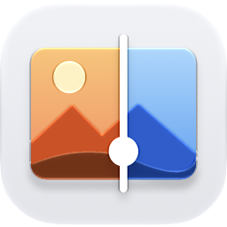

<p align="center">
  <picture>
    <source media="(prefers-color-scheme: dark)" srcset="docs/icon-dark.png">
    
  </picture>
</p>

<h1 align="center">Comparator</h1>

<p align="center">Small and fast image comparison tool for macOS.</p>

- Switch between images without losing your place.
- Split view with a draggable divider.
- Difference view to highlight the pixels that don't match.
- Noise view that shows faint color patches and fine detail.
- Move, nudge, or scale an image to line it up with another.
- Images reload automatically when they change on disk.

## Install

Requires macOS 15 or later. Download `Comparator-<version>.dmg` from the [latest release](https://github.com/chalish-b/comparator/releases/latest), open it, and drag Comparator into Applications.

Comparator isn't signed with an Apple developer certificate, so the first time you open it, macOS says it can't verify the app. To allow it, run this in Terminal:

```sh
xattr -dr com.apple.quarantine /Applications/Comparator.app
```

Or click **Done**, open **System Settings → Privacy & Security**, scroll down to the message about Comparator, and click **Open Anyway**.

You need to do this again after downloading a new version.

## Build

Requires the Xcode Command Line Tools.

```sh
./scripts/build-app.sh --release            # builds build/Comparator.app
./scripts/build-app.sh --release --install  # also installs to ~/Applications and registers it with Finder
```

Quit the app before reinstalling.

The app icon is `Resources/AppIcon.icon`, made with Icon Composer. After editing it, run `./scripts/compile-icon.sh` (requires Xcode) and commit the updated `Resources/AppIcon/` and `docs/icon-*.png`.

## Opening images

- Select images in Finder → right-click → **Open With → Comparator**, or drop them on the Dock icon. Each opens as a new set (window or tab).
- Drop images or folders onto a window to add them to that set.
- **⌘T** new empty set, **⌘O** open as a new set, **⇧⌘O** add to the current set.
- Images that change on disk reload automatically, keeping your view.

## Shortcuts

| Key | Action |
| --- | --- |
| 1–9 | Show image |
| Tab | Flip to the last viewed image |
| ↑ ↓ | Previous / next image |
| S | Split view (lower-numbered image on the left) |
| D | Difference view |
| N | Noise view |
| [ ] | Difference gain, or noise view strength |
| , . | Noise view radius |
| P | Pixels / smooth filtering |
| 0 or F | Fit |
| A | Actual pixels (100%) |
| + − | Zoom in / out |
| Double-click | Fit / 100% |
| Drag, two-finger scroll | Pan |
| Pinch, mouse wheel | Zoom |
| Hold ⌥ | Alignment overlay of the current image over the last viewed one |
| ⌥ drag | Move the current image |
| ⌥ arrows | Nudge by 1 px (⇧ for 10 px) |
| ⌥ scroll / pinch | Scale the current image |
| ⌥R | Reset alignment |
| O | Alignment overlay style: difference / onion skin |
| ⌫ | Remove the image from the set |
| H | Show / hide shortcuts |

100% zoom means one pixel of the highest-resolution image per screen pixel. Smaller images (e.g. an upscaler's input) are scaled to match it.
